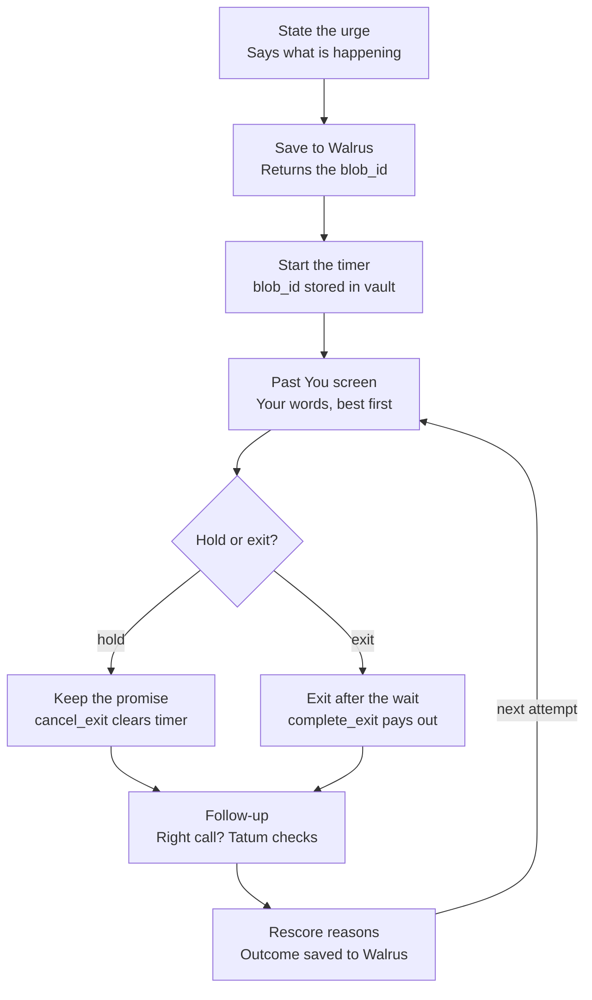
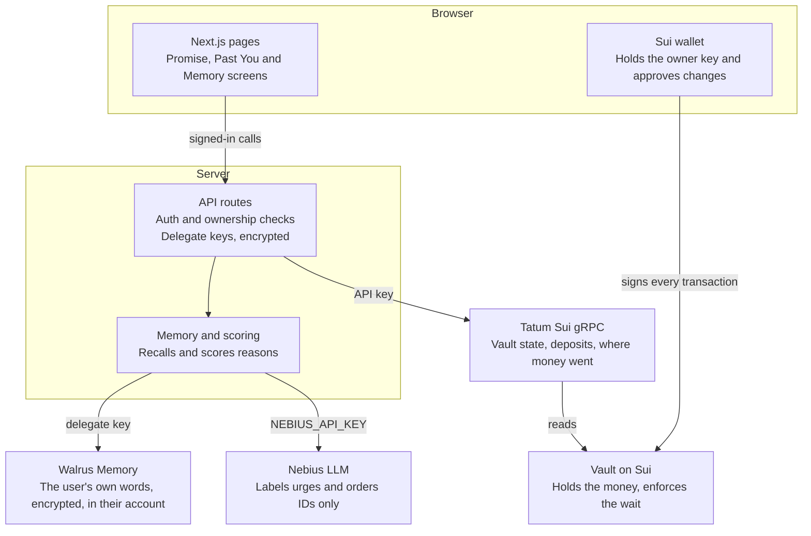

<h1 align="center">Past You</h1>

**What if the one who talks you out of breaking a savings promise is you, the day you made it?**

<p align="center">
  
  
  
  
  
  
  
  
</p>

<p align="center">
  <b>Total Recall hackathon · Consumer Finance Apps · Best Walrus Memory</b> · Testnet first · Contract unaudited
</p>

| |
| --- |
| [The problem](#the-problem) · [What it does](#what-past-you-does) · [How it works](#how-it-works) · [Architecture](#architecture) · [Tech stack](#tech-stack) · [Quickstart](#quickstart) · [Testnet runbook](#testnet-runbook) · [Commands](#commands) · [Demo mode](#demo-mode) · [Learning logic](#learning-logic) · [Repository layout](#repository-layout) · [Checks](#checks) · [Safety and trust](#safety-and-trust) · [Troubleshooting](#troubleshooting) · [Scope notes](#honest-scope-notes) |

## The problem

People break savings promises in the moment, when the reason they made them is out of mind. A time lock delays the action but says nothing about why it mattered. A reminder is easy to dismiss.

| Existing approach | What it does | What it misses |
| --- | --- | --- |
| Time-locked vault | Delays the withdrawal | Never reminds you why |
| Commitment or habit app | Tracks streaks, may charge a penalty | Relies on self-report, and doesn't learn what persuades you |
| **Past You** | Waits, shows your own words, learns what worked | Only protects money placed in the vault |

## What Past You does

You lock money in a Sui vault with a written reason. The app steps in only when you try to break the promise.

- **A waiting period, enforced onchain.** Early exit needs a wait of up to 7 days. The app never holds the money, and the contract has no admin key.
- **Your own words, back at the right moment.** The Past You screen shows what you wrote, with dates, in large type. Counts sit below in small type. No warnings, no red banners, no guilt.
- **A screen that changes between attempts.** Reasons that have stopped you before move to the top. Reasons that preceded a regretted exit are weighted too.
- **Memory you own.** Reasons, urges and outcomes live in your Walrus Memory account. The app is a delegate you can remove.

The demo ends on one line: *Nobody lectured this person. They just heard from themselves.*

## How it works



1. **Promise.** Lock an amount with an unlock date, a wait, and a reason. The reason is stored word for word.
2. **Urge.** Trying to break it asks "What's going on right now?". The answer is saved with `rememberAndWait` and its `blob_id` is written into the vault.
3. **Wait.** The timer runs onchain whatever the screen does. The Past You screen shows your top three reasons.
4. **Decide.** Keep the promise (`cancel_exit`) or exit once the wait is over (`complete_exit`). Completing early fails onchain.
5. **Follow up.** The app asks if it was the right call and checks through Tatum where the money went. The finding is saved as an outcome memory.
6. **Learn.** Results rescore every reason, so the next attempt looks different. An early exit closes the vault, so you can lock the promise again.

After the unlock date, `withdraw` works with no wait and no prompts.

## Architecture

The money path and the memory path are separate, so a compromised server can read memories but can't touch funds.



**Vault** (`past_you::vault`). `Vault<T>` has `key` only, so it can't be moved by generic transfer calls.

| Function | Rule | Event |
| --- | --- | --- |
| `create<T>` | Unlock is in the future; wait ≤ 7 days | `PromiseCreated` |
| `deposit<T>` | Blocked while an exit is pending | `Deposited` |
| `request_early_exit<T>` | No exit already pending; stores the urge's `blob_id` | `ExitRequested` |
| `cancel_exit<T>` | An exit is pending; clears the timer | `ExitCancelled` |
| `complete_exit<T>` | Clock ≥ request + wait; pays out and deletes the vault | `ExitCompleted` |
| `withdraw<T>` | Clock ≥ unlock; works even with an exit pending | `Withdrawn` |

The wallet signs every vault transaction. The server holds a delegate key for memory only, encrypted at rest. It never holds a key that can move funds.

## Tech stack

| Layer | What it is |
| --- | --- |
| **Contract** | Sui Move (2024 edition), one module, no admin key |
| **App** | Next.js 15 · React 19 · TypeScript 5 (strict) · plain CSS with light and dark themes |
| **Wallet** | `@mysten/dapp-kit-core` · `@mysten/sui` · sign-in by signed message with a 10-minute window |
| **Memory** | [Walrus Memory](https://docs.wal.app/walrus-memory) via `@mysten-incubation/memwal`, one namespace per promise |
| **Chain data** | [Tatum](https://docs.tatum.io) Sui gRPC, API key sent server-side only |
| **Model** | [Nebius Token Factory](https://tokenfactory.nebius.com), OpenAI-compatible. Labels urges and orders IDs. Never writes user-visible text. |
| **Storage** | SQLite via better-sqlite3. Holds no text the user wrote. |
| **Tooling** | vitest · tsx · Playwright for screenshots |

## Quickstart

Requires Node 20.9+. The Sui CLI is needed only for the contract.

```bash
git clone https://github.com/fozagtx/PastU && cd PastU
cp .env.example .env.local        # MEMORY_MODE=fake works offline
npm install
npm run smoke                     # sanity check
npm run dev                       # http://localhost:3000, try /demo first
```

`/demo` runs the three-attempt story with a made-up persona and needs no wallet or backend.

## Testnet runbook

The vault runs on testnet with free coins. Walrus Memory's hosted relayer is Mainnet-only, so keep `MEMORY_MODE=fake` until you want real writes.

1. Publish the contract:
   ```bash
   cd contracts
   sui client switch --env testnet && sui client faucet
   sui move test && sui client publish
   ```
   Copy the package ID.
2. Set `.env.local`: `NEXT_PUBLIC_SUI_NETWORK=testnet`, `NEXT_PUBLIC_VAULT_PACKAGE_ID=<id>`, `NEXT_PUBLIC_COIN_TYPE=0x2::sui::SUI`, `MEMORY_MODE=fake`, and `TATUM_API_KEY` if you have one.
3. Run `npm run dev`, set the wallet to testnet, claim faucet SUI, and walk through `/promise/new` with the 60-second wait.
4. Before submitting, switch to `mainnet`, set the real coin type and relayer URL, and keep deposits capped.

## Commands

| Command | What it does |
| --- | --- |
| `npm run dev` | Start the app on port 3000 |
| `npm run build` · `npm start` | Production build and server |
| `npm test` | vitest: scoring, tags, crypto, LLM fallback, full 3-attempt flow |
| `npm run typecheck` | `tsc --noEmit` |
| `npm run smoke` | Memory write and exact recall; checks Tatum if a key is set |
| `cd contracts && sui move test` | The 13 Move tests |

**Environment variables** (see `.env.example`)

| Variable | Purpose |
| --- | --- |
| `NEXT_PUBLIC_SUI_NETWORK` | `testnet` (default) or `mainnet`. Drives wallet, Sui client and Tatum URL. |
| `NEXT_PUBLIC_VAULT_PACKAGE_ID` · `NEXT_PUBLIC_COIN_TYPE` · `NEXT_PUBLIC_DEPOSIT_CAP` | Contract and deposit cap |
| `SESSION_SECRET` · `DELEGATE_KEY_SECRET` | Required in production unless `MEMORY_MODE=fake` |
| `MEMORY_MODE` · `MEMWAL_RELAYER_URL` | `fake` or `real`; the Walrus relayer |
| `TATUM_API_KEY` | Vault state and post-exit findings |
| `NEBIUS_API_KEY` · `NEBIUS_MODEL` | Optional. Without them the code's order is used. |
| `DB_PATH` · `FOLLOW_UP_MS` | SQLite file; follow-up delay (default 24h) |

## Demo mode

`/demo` shows the same promise across three attempts with an invented persona, Maya, clearly labelled. The quote order changes visibly between attempts, and a table beside it shows how each reason's rank moves. A 60-second timer drives a disabled Withdraw button.

With `MEMORY_MODE=fake`, the whole app runs on an in-memory store, so the real flow works without keys. Walrus records real write times, so the demo presents learning by attempt number rather than pretending weeks have passed.

## Learning logic

Plain code scores each reason. The model only labels the urge and suggests an order.

```
score = (h + 0.5g + 1) / (s + 2) + 0.25c
```

| Term | Meaning |
| --- | --- |
| `s` | Attempts where this reason was shown |
| `h` | Of those, attempts where the user held |
| `g` | Of those, attempts where the user exited and later regretted it |
| `c` | 1 if this reason held during a similar past urge, otherwise 0 |

A new reason starts at 0.5, so it gets tried. The weights are starting values to adjust once real attempts exist.

**On each attempt:** the model labels the urge (loss, payday, stress, boredom, social, emergency, other), code scores every reason and keeps the top three, the model may reorder those three by ID, and the server fills fixed sentence templates with the counts. If the model fails, returns bad JSON or an unknown ID, the screen falls back to code's order.

**Memory tags** are plain text at the start of each memory, parsed by server code:

| Type | Format |
| --- | --- |
| Reason | `[reason id=r1] This is my rent deposit...` |
| Urge | `[urge attempt=2 trigger=loss] Down 200 on a bet...` |
| Shown | `[shown attempt=2 reasons=r1,r3]` |
| Decision | `[decision attempt=2 result=held]` |
| Outcome | `[outcome attempt=1 felt=regret] 190 USDC went to an exchange within an hour` |
| Habit | `[habit week=3 result=missed] Payday weekend, forgot` |

## Repository layout

```
PastU/
├── contracts/
│   ├── sources/vault.move         # past_you::vault
│   ├── tests/vault_tests.move     # 13 tests: boundaries, caps, payout
│   └── README.md                  # build, test, publish
├── src/
│   ├── app/
│   │   ├── page.tsx · demo/       # landing and the no-wallet walkthrough
│   │   ├── promise/               # new · [id] · break · past-you · follow-up · memory
│   │   └── api/                   # auth · account · promises · attempts routes
│   ├── components/                # Past You screen, countdown, blob links, wallet gate
│   └── lib/
│       ├── types.ts               # shared API contract
│       ├── client/                # wallet, vault PTBs, typed fetch client
│       └── server/
│           ├── memory.ts          # Walrus Memory behind one interface, plus a fake
│           ├── scoring.ts         # the formula and top-three selection
│           ├── llm.ts             # Nebius labelling and reordering, with fallback
│           ├── tatum.ts           # vault state and post-exit findings
│           ├── tags.ts            # memory tag format and parsing
│           ├── crypto.ts          # AES-256-GCM for delegate keys
│           ├── session.ts · db.ts # signed cookie, SQLite
│           └── service.ts         # Past You assembly
├── tests/                         # unit and full-flow tests
├── scripts/smoke.ts               # npm run smoke
└── .env.example
```

## Checks

```bash
npm test                  # 26 tests
npm run typecheck
npm run build
cd contracts && sui move test
```

The tests cover:

- the score formula, ties and the `c` bonus
- that different results give a different order on the next attempt
- exact stored text in quotes, with count templates
- the ownership guards (401 and 404) and body validation
- AES-GCM round trip and tamper detection
- Nebius fallback on bad JSON, unknown IDs, no key and HTTP errors
- the emergency case showing only the timer
- that SQLite holds no user-written text

The Move tests cover `complete_exit` at the exact millisecond and one before, double requests, cancel and re-request, `withdraw` with an exit pending, the wait cap, past unlock dates, deposits during an exit, and payout equal to deposits.

## Safety and trust

The app can slow someone down, but it must never trap them, shame them or misrepresent what they said.

- **Money stays reachable.** No admin key, and the wait can't exceed 7 days.
- **Emergencies get no argument.** If the urge is labelled emergency, or mentions health or safety, the screen shows only the timer. The label can't shorten the onchain wait, and the app says so at promise time.
- **Quotes are exact.** Only stored text appears in quote styling.
- **No shame.** Templates report what happened and never scold.
- **Memory is lasting.** No delete method is documented, so don't write other people's private details.
- **Revoking is honest.** Removal stops future access. It doesn't erase what the app already read or re-encrypt old memories.
- **Keys stay separated.** The owner key stays in the wallet. Delegate keys are encrypted at rest. Tatum and Nebius keys stay on the server.
- **Model calls are disclosed.** The urge and top reasons go to Nebius for labelling and ordering. Turn on Zero Data Retention in the Nebius account.
- **The contract is unaudited.** Deposits are capped. Do not use real funds.
- **Demo data is made up.**

## Troubleshooting

**`sui: command not found`**
Install the Sui CLI to build, test and publish the contract. The app itself doesn't need it.

**The app shows a wallet error on a different network.**
Check `NEXT_PUBLIC_SUI_NETWORK` and the wallet's selected network match.

**Vault calls fail with "function not found".**
`NEXT_PUBLIC_VAULT_PACKAGE_ID` is empty or from another network. Republish and update `.env.local`.

**`SESSION_SECRET is required in production`**
Set `SESSION_SECRET` and `DELEGATE_KEY_SECRET`, or run with `MEMORY_MODE=fake` for a demo.

**Sign-in fails with an expired message.**
The signed message must have an `Issued:` time within the last 10 minutes. Sign in again.

**The Past You screen order never changes.**
Order comes from stored decisions and outcomes. Answer the follow-up after each attempt. Without a Nebius key the code's order is used, which is fine.

**Tatum findings say "unavailable".**
Set `TATUM_API_KEY`. If the key is set, the gateway may not accept grpc-web, which `@mysten/sui`'s client uses.

## Honest scope notes

- **Not run yet:** the Move tests (no Sui CLI in the build sandbox), and the wallet, Walrus, Tatum and Nebius paths against live services. The backend flow is tested on a fake memory store.
- **Re-lock** creates a new promise rather than attaching a new vault to the old one, so history does not carry over yet.
- **Revoke** removes the app's access to every memory, not one at a time.
- **JSON-RPC:** the browser reads chain state over JSON-RPC, which Sui has disabled on some Mainnet nodes. Move it to gRPC before the Mainnet switch.
- **Open:** Mainnet package and coin IDs, Tatum support for `ListTransactions`, `ListEvents` and `ListOwnedObjects`, and the similarity threshold for a "similar urge".
- **Not in this version:** streaks, badges, price-based promises, trusted contacts, partial exits, native apps, agent payments.
- **Habit tracking** (one weekly deposit, confirmed through Tatum) is a Should item and only partly built.
- Claims stay modest: no promise of better finances, and no treatment claims.
