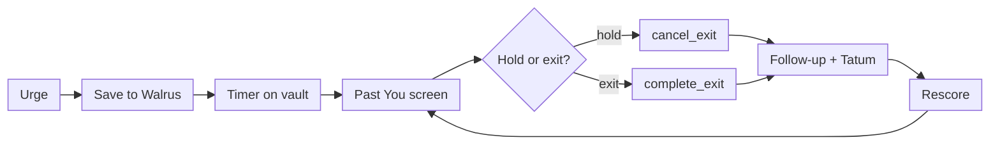
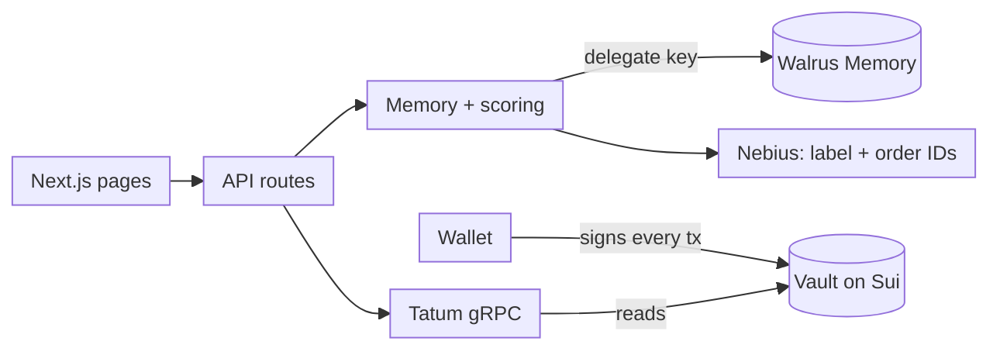

<h1 align="center">Past You</h1>

**What if the one who talks you out of breaking a savings promise is you, the day you made it?**

<p align="center">
  <a href="https://sui.io"></a>
  <a href="https://www.walrus.xyz"></a>
  <a href="https://tatum.io"></a>
</p>

<p align="center">
  
  
  
  
  
  
  
  
  
</p>

<p align="center">
  <b>Total Recall hackathon · Consumer Finance Apps · Best Walrus Memory</b> · Testnet first · Contract unaudited
</p>

<p align="center">
  <b>Live:</b> <a href="https://pastyou.vercel.app">pastyou.vercel.app</a> · <b>No wallet needed:</b> <a href="https://pastyou.vercel.app/story">Maya’s story</a> · <a href="https://pastyou.vercel.app/how">How it works</a>
</p>

| |
| --- |
| [The problem](#the-problem) · [Deployed contract](#deployed-contract) · [What it does](#what-past-you-does) · [How it works](#how-it-works) · [Architecture](#architecture) · [Tech stack](#tech-stack) · [Quickstart](#quickstart) · [Get your keys and IDs](#get-your-keys-and-ids) · [Testnet runbook](#testnet-runbook) · [Commands](#commands) · [Demo mode](#demo-mode) · [Learning logic](#learning-logic) · [Repository layout](#repository-layout) · [Checks](#checks) · [Safety and trust](#safety-and-trust) · [Troubleshooting](#troubleshooting) · [Scope notes](#honest-scope-notes) |

## The problem

People break savings promises in the moment, when the reason they made them is out of mind. A time lock delays the action but says nothing about why it mattered. A reminder is easy to dismiss.

| Existing approach | What it does | What it misses |
| --- | --- | --- |
| Time-locked vault | Delays the withdrawal | Never reminds you why |
| Commitment or habit app | Tracks streaks, may charge a penalty | Relies on self-report, and doesn't learn what persuades you |
| **Past You** | Waits, shows your own words, learns what worked | Only protects money placed in the vault |

## Deployed contract

The vault contract is live on **Sui testnet**. Anyone can inspect it.

| | |
| --- | --- |
| Network | Sui testnet (chain id `4c78adac`) |
| Package ID | [`0x40ca229b92486eb521391f2290ff44d992a85e8f60dd1a4dafbbcf52048965a3`](https://suiscan.xyz/testnet/object/0x40ca229b92486eb521391f2290ff44d992a85e8f60dd1a4dafbbcf52048965a3) |
| Module | `past_you::vault` |
| Publish transaction | [`7hAvrmXDn4rE7qXCkoJX56kAXndkFk8F3Dju72zqNyKt`](https://suiscan.xyz/testnet/tx/7hAvrmXDn4rE7qXCkoJX56kAXndkFk8F3Dju72zqNyKt) |
| Publisher | `0xe63a423e9f452defdea24299bdfb09de64c4d3c5c9414cf265f991808ce7858f` |
| Upgrade capability | `0x1d4429e790222e00884ef8214a0c065acf6463ce6d4587211cd0413a50f93d64` (held by the publisher) |
| Walrus Memory account | `0x2d18637972623a08617e34ec68867db460a06f27e5d5e8c02b2cb99a000a6070` (testnet) |
| Walrus Memory agent ID | `21449ed62deff336332aa93e3a7e56d73416a49f3b02c25cca5764242b2bea75` (public key) |
| Toolchain | Sui CLI 1.73.0, Move edition 2024 |
| Tests | 14 Move tests pass (`cd contracts && sui move test`) |
| Status | **Unaudited.** Do not use funds you cannot afford to lose. |

**What a vault is.** `Vault<T>` is an object owned by whoever created it. It holds a balance, an unlock time and a wait length. It has the `key` ability only, so it cannot be wrapped or handed to another address with `public_transfer`. Only the owner can touch it.

**The rules, in order**

1. `create` locks a coin until `unlock_ms`. The unlock time must be in the future, and the wait can be at most 7 days (`604_800_000` ms).
2. `deposit` adds more, but is blocked while an exit is pending.
3. `request_early_exit` starts the cooling-off timer and stores a pointer to the reason you wrote (a Walrus blob id).
4. `cancel_exit` clears the timer and the reason. You can request again later and the timer starts fresh.
5. `complete_exit` pays out the full balance once `clock >= requested + wait`. The vault is deleted.
6. `withdraw` pays out once `clock >= unlock_ms`, even if an exit is pending.

**Errors** (abort codes): `0` unlock in the past, `1` wait too long, `2` exit already pending, `3` no exit pending, `4` exit not ready, `5` still locked.

**Events** the app reads through Tatum: `PromiseCreated`, `Deposited`, `ExitRequested`, `ExitCancelled`, `ExitCompleted`, `Withdrawn`.

**Honest note on admin power.** The contract has no admin function, no pause and no way to move anyone's funds. The publish did, however, create an **upgrade capability** held by the publisher, which lets the publisher ship a new version of the package. Old vaults keep the old rules only if the package is made immutable. Before real funds are used, either burn the capability (`sui::package::make_immutable`) or hand it to a multisig, and say which in this table.

Everything else about the contract is in [`contracts/README.md`](contracts/README.md).

## What Past You does

You lock money in a Sui vault with a written reason. The app steps in only when you try to break the promise.

- **A waiting period, enforced onchain.** Early exit needs a wait of up to 7 days. The app never holds the money, and the contract has no admin key.
- **Your own words, back at the right moment.** The Past You screen shows what you wrote, with dates, in large type. Counts sit below in small type. No warnings, no red banners, no guilt.
- **A screen that changes between attempts.** Reasons that have stopped you before move to the top. Reasons that preceded a regretted exit are weighted too.
- **Memory you own.** Reasons, urges and outcomes live in your Walrus Memory account. The app is a delegate you can remove.

The demo ends on one line: *Nobody lectured this person. They just heard from themselves.*

## How it works



1. **Promise.** Lock an amount with an unlock date, a wait, and a reason. The reason is stored word for word.
2. **Urge.** Trying to break it asks "What's going on right now?". The answer is saved with `rememberAndWait` and its `blob_id` is written into the vault.
3. **Wait.** The timer runs onchain whatever the screen does. The Past You screen shows your top three reasons.
4. **Decide.** Keep the promise (`cancel_exit`) or exit once the wait is over (`complete_exit`). Completing early fails onchain.
5. **Follow up.** The app asks if it was the right call and checks through Tatum where the money went. The finding is saved as an outcome memory.
6. **Learn.** Results rescore every reason, so the next attempt looks different. An early exit closes the vault, so you can lock the promise again.

After the unlock date, `withdraw` works with no wait and no prompts.

## Architecture

The money path and the memory path are separate, so a compromised server can read memories but can't touch funds.

<details>
<summary><b>Architecture diagram</b> (click to expand)</summary>



</details>

**Vault** (`past_you::vault`). `Vault<T>` has `key` only, so it can't be moved by generic transfer calls.

| Function | Rule | Event |
| --- | --- | --- |
| `create<T>` | Unlock is in the future; wait ≤ 7 days | `PromiseCreated` |
| `deposit<T>` | Blocked while an exit is pending | `Deposited` |
| `request_early_exit<T>` | No exit already pending; stores the urge's `blob_id` | `ExitRequested` |
| `cancel_exit<T>` | An exit is pending; clears the timer | `ExitCancelled` |
| `complete_exit<T>` | Clock ≥ request + wait; pays out and deletes the vault | `ExitCompleted` |
| `withdraw<T>` | Clock ≥ unlock; works even with an exit pending | `Withdrawn` |

The wallet signs every vault transaction. The server holds a delegate key for memory only, encrypted at rest. It never holds a key that can move funds.

## Tech stack

| Layer | What it is |
| --- | --- |
| **Contract** | Sui Move (2024 edition), one module, no admin key |
| **App** | Next.js 15 · React 19 · TypeScript 5 (strict) · plain CSS with light and dark themes |
| **Wallet** | `@mysten/dapp-kit-core` · `@mysten/sui` over gRPC (public Sui JSON-RPC is deprecated) · sign-in by signed message with a 10-minute window |
| **Memory** | [Walrus Memory](https://docs.wal.app/walrus-memory) via `@mysten-incubation/memwal`, one namespace per promise |
| **Chain data** | [Tatum](https://docs.tatum.io) Sui gRPC gateway over native gRPC (`@grpc/grpc-js`), API key sent server-side only |
| **Model** | [Nebius Token Factory](https://tokenfactory.nebius.com) (`Qwen/Qwen3-30B-A3B-Instruct-2507`), with the Neon AI Gateway as a fallback. Labels urges and orders IDs. Never writes user-visible text. |
| **Storage** | [Neon](https://neon.com) Postgres via `pg` (pooled URL on Vercel). Schema in `db/schema.sql`, applied by `npm run migrate`. Holds no text the user wrote. |
| **Hosting** | Vercel. The build runs the migration first. |
| **Tooling** | vitest on in-memory Postgres (PGlite) · tsx · Playwright for screenshots |

## Quickstart

Requires Node 20.9+. The Sui CLI is needed only for the contract.

```bash
git clone https://github.com/fozagtx/PastU && cd PastU
cp .env.example .env.local        # add your secrets; public URLs live in src/lib/config.ts
npm install
npm run migrate                   # create tables in your Neon database
npm run smoke                     # sanity check
npm run dev                       # http://localhost:3000, try /story first
```

`/story` runs the three-attempt story with a made-up persona and needs no wallet or backend.

## Get your keys and IDs

Every value goes in `.env.local` (local) or the Vercel project settings (deploy). Never commit them. Only `NEXT_PUBLIC_*` values reach the browser.

| Value | Where to get it |
| --- | --- |
| `SESSION_SECRET`, `DELEGATE_KEY_SECRET` | Generate two separate secrets: `openssl rand -hex 32` |
| `TATUM_API_KEY` | Sign up at [dashboard.tatum.io](https://dashboard.tatum.io), create an API key, and copy it. Your **account ID** for the hackathon form is shown in the same dashboard. Use a key that covers the network you run on. |
| `NEBIUS_API_KEY` | Sign up at [tokenfactory.nebius.com](https://tokenfactory.nebius.com), open the API keys page and create a key. The model ID is a constant in `src/lib/config.ts`. In account settings, turn on Zero Data Retention, since prompts are stored by default. [API docs](https://docs.tokenfactory.nebius.com/api-reference/introduction.md). |
| `NEXT_PUBLIC_VAULT_PACKAGE_ID` | Printed when you publish the contract: look for `PackageID` under *Published Objects* after `sui client publish`. Testnet and Mainnet have different IDs. |
| `NEXT_PUBLIC_COIN_TYPE` | Testnet: `0x2::sui::SUI`. Mainnet: the USDC coin type. Confirm it in a Sui explorer (Suiscan) before using real funds; it is still an open item. |
| Walrus relayer URL | Not an env var. `src/lib/config.ts` picks it from the network: testnet `https://relayer.dev.memwal.ai`, mainnet `https://relayer.memory.walrus.xyz`. See the [Walrus Memory docs](https://docs.wal.app/walrus-memory/sdk/quick-start). |
| `MEMWAL_AGENT_ID` (hackathon form) | The **delegate public key** of the app's Walrus Memory agent: `21449ed62deff336332aa93e3a7e56d73416a49f3b02c25cca5764242b2bea75`. Users never see or handle it; the app uses one shared agent, set by `MEMWAL_PRIVATE_KEY` and `MEMWAL_ACCOUNT_ID` on the server. |
| `DATABASE_URL` · `DATABASE_URL_UNPOOLED` | Neon: run `neon init` then `neon deploy` in the repo, which writes both into `.env.local`. The pooled URL serves the app; the direct one runs migrations. |
| `MEMWAL_PRIVATE_KEY` · `MEMWAL_ACCOUNT_ID` | The shared Walrus Memory agent. Create an account and a delegate key at [dev.memwal.ai](https://dev.memwal.ai) (testnet) or [memory.walrus.xyz](https://memory.walrus.xyz) (mainnet). Server-only secrets. |
| Walrus Memory `packageId` / `registryId` | Served by each relayer at `/config`. Testnet: package `0x0a625e2db2af6f591a4c80a3d8551ddf11656089cc3a20c5e9e7f8fb75b9265c`, registry `0x736aef9906798fca4460490ccdf8e8502ef170122dc26ecae32111b78c6b42dd`. Mainnet: package `0xe7c16fbea0560e7057e2bf7422feaa4fb313749fc69c9e9092fac7a33b81d7f5`, registry `0x8bf82c9e09e36b8d1c38298f68b7cb68e7b8762887e7592add9986d5e9cf199f`. |

## Testnet runbook

The vault runs on testnet with free coins, and Walrus Memory has a hosted testnet relayer (`https://relayer.dev.memwal.ai`, dashboard `dev.memwal.ai`), so the whole app can run on testnet. The app picks the relayer from `NEXT_PUBLIC_SUI_NETWORK`. For offline work only, set `MEMORY_MODE=fake`.

**1. Install the Sui CLI.** Follow the [Sui install guide](https://docs.sui.io/guides/developer/getting-started/sui-install) (Homebrew: `brew install sui`, or use `suiup`). Check with `sui --version`.

**2. Point it at testnet and get free coins.**

```bash
sui client new-env --alias testnet --rpc https://fullnode.testnet.sui.io:443   # skip if it exists
sui client switch --env testnet
sui client active-address            # your address
sui client faucet                    # free test SUI; or use https://faucet.sui.io
sui client gas                       # confirm you have a balance
```

**3. Test and publish the contract.**

```bash
cd contracts
sui move test                        # all 14 tests should pass
sui client publish --gas-budget 200000000
```

Copy the `PackageID` from the output. The contract compiles and the tests pass. This repo is already published; see [Deployed contract](#deployed-contract).

**4. Configure the app.** In `.env.local`:

```bash
NEXT_PUBLIC_SUI_NETWORK=testnet
NEXT_PUBLIC_VAULT_PACKAGE_ID=<PackageID>
NEXT_PUBLIC_COIN_TYPE=0x2::sui::SUI
NEXT_PUBLIC_DEPOSIT_CAP=10
DATABASE_URL=<neon pooled url>
DATABASE_URL_UNPOOLED=<neon direct url>
MEMWAL_PRIVATE_KEY=<delegate private key>
MEMWAL_ACCOUNT_ID=<walrus memory account id>
TATUM_API_KEY=<testnet key>
NEBIUS_API_KEY=<key>
```

**5. Try it.** Run `npm run smoke`, then `npm run dev`. Set your wallet (Slush or any Sui wallet) to **Testnet**, claim faucet SUI in it, and walk through `/promise/new` with the 60-second wait. Request an exit, watch the countdown, then cancel or complete it.

**6. Before submitting.** Switch `NEXT_PUBLIC_SUI_NETWORK=mainnet`, publish to Mainnet, set the real coin type and a mainnet Walrus Memory account (the relayer switches with the network), and keep deposits capped. The hackathon needs at least 10 Walrus Memory writes on Mainnet.

## Commands

| Command | What it does |
| --- | --- |
| `npm run dev` | Start the app on port 3000 |
| `npm run build` · `npm start` | Production build and server |
| `npm test` | vitest on in-memory Postgres: scoring, tags, crypto, LLM fallback, full 3-attempt flow. Set `TEST_DATABASE_URL` to run against a throwaway Neon branch. |
| `npm run typecheck` | `tsc --noEmit` |
| `npm run smoke` | Memory write and exact recall; checks Tatum if a key is set |
| `npm run migrate` | Apply `db/schema.sql` over the direct Neon URL |
| `cd contracts && sui move test` | The 14 Move tests |

**Environment variables** (see `.env.example`)

| Variable | Purpose |
| --- | --- |
| `NEXT_PUBLIC_SUI_NETWORK` | `testnet` (default) or `mainnet`. Drives wallet, Sui client and Tatum URL. |
| `NEXT_PUBLIC_VAULT_PACKAGE_ID` · `NEXT_PUBLIC_COIN_TYPE` · `NEXT_PUBLIC_DEPOSIT_CAP` | Contract and deposit cap |
| `SESSION_SECRET` · `DELEGATE_KEY_SECRET` | Required in production |
| `DATABASE_URL` · `DATABASE_URL_UNPOOLED` | Neon Postgres: pooled for the app, direct for migrations |
| `MEMWAL_PRIVATE_KEY` · `MEMWAL_ACCOUNT_ID` | Shared Walrus Memory agent. Without them, each wallet gets its own encrypted delegate key that must be registered on a Walrus account. |
| `TATUM_API_KEY` | Vault state and post-exit findings |
| `NEBIUS_API_KEY` | Optional. Without it (and without the Neon AI Gateway) the code's order is used. |
| `NEON_AI_GATEWAY_TOKEN` · `NEON_AI_GATEWAY_BASE_URL` | Optional fallback model provider |
| `MEMORY_MODE` | `fake` only for offline development and tests; the default is real Walrus Memory |
| `FOLLOW_UP_MS` | Follow-up delay (default 24h) |

Public endpoints (Walrus relayer and aggregator, Tatum gateway, Nebius base URL) are constants in `src/lib/config.ts`, chosen by network, not environment variables.

## Demo mode

`/story` (the old `/demo` redirects here) shows the same promise across three attempts with an invented persona, Maya, clearly labelled. The quote order changes visibly between attempts, and a table beside it shows how each reason's rank moves. A 60-second timer drives a disabled Withdraw button.

For offline development, `MEMORY_MODE=fake` runs the whole app on an in-memory store, so the flow works without keys. Walrus records real write times, so the demo presents learning by attempt number rather than pretending weeks have passed.

## Learning logic

Plain code scores each reason. The model only labels the urge and suggests an order.

```
score = (h + 0.5g + 1) / (s + 2) + 0.25c
```

| Term | Meaning |
| --- | --- |
| `s` | Attempts where this reason was shown |
| `h` | Of those, attempts where the user held |
| `g` | Of those, attempts where the user exited and later regretted it |
| `c` | 1 if this reason held during a similar past urge, otherwise 0 |

A new reason starts at 0.5, so it gets tried. The weights are starting values to adjust once real attempts exist.

**On each attempt:** the model labels the urge (loss, payday, stress, boredom, social, emergency, other), code scores every reason and keeps the top three, the model may reorder those three by ID, and the server fills fixed sentence templates with the counts. If the model fails, returns bad JSON or an unknown ID, the screen falls back to code's order.

**Memory tags** are plain text at the start of each memory, parsed by server code:

| Type | Format |
| --- | --- |
| Reason | `[reason id=r1] This is my rent deposit...` |
| Urge | `[urge attempt=2 trigger=loss] Down 200 on a bet...` |
| Shown | `[shown attempt=2 reasons=r1,r3]` |
| Decision | `[decision attempt=2 result=held]` |
| Outcome | `[outcome attempt=1 felt=regret] 190 USDC went to an exchange within an hour` |
| Habit | `[habit week=3 result=missed] Payday weekend, forgot` |

## Repository layout

```
PastU/
├── contracts/
│   ├── sources/vault.move         # past_you::vault
│   ├── tests/vault_tests.move     # 14 tests: boundaries, caps, payout
│   └── README.md                  # build, test, publish
├── src/
│   ├── app/
│   │   ├── page.tsx · story/ · how/ # landing, Maya's story (no wallet), onboarding
│   │   ├── promise/               # new · [id] · break · past-you · follow-up · memory
│   │   └── api/                   # auth · account · promises · attempts routes
│   ├── components/                # Past You screen, onboarding, illustrations, wallet gate
│   └── lib/
│       ├── config.ts              # public endpoints and model IDs, by network
│       ├── types.ts               # shared API contract
│       ├── client/                # wallet, vault PTBs, typed fetch client
│       └── server/
│           ├── memory.ts          # Walrus Memory behind one interface, plus a fake
│           ├── scoring.ts         # the formula and top-three selection
│           ├── llm.ts             # Nebius labelling and reordering, with fallback
│           ├── tatum.ts           # vault state and post-exit findings
│           ├── tags.ts            # memory tag format and parsing
│           ├── crypto.ts          # AES-256-GCM for delegate keys
│           ├── session.ts · db.ts # signed cookie, Postgres (pg; PGlite in tests)
│           └── service.ts         # Past You assembly
├── db/schema.sql                  # tables: users, promises, attempts, habits
├── tests/                         # unit and full-flow tests
├── scripts/                       # smoke.ts, migrate.ts
├── neon.ts                        # Neon services for this project
└── .env.example
```

## Checks

```bash
npm test                  # 26 tests
npm run typecheck
npm run build
cd contracts && sui move test
```

The tests cover:

- the score formula, ties and the `c` bonus
- that different results give a different order on the next attempt
- exact stored text in quotes, with count templates
- the ownership guards (401 and 404) and body validation
- AES-GCM round trip and tamper detection
- Nebius fallback on bad JSON, unknown IDs, no key and HTTP errors
- the emergency case showing only the timer
- that the database holds no user-written text

The Move tests cover `complete_exit` at the exact millisecond and one before, double requests, cancel and re-request, `withdraw` with an exit pending, the wait cap, past unlock dates, deposits during an exit, and payout equal to deposits.

## Safety and trust

The app can slow someone down, but it must never trap them, shame them or misrepresent what they said.

- **Money stays reachable.** No admin function in the contract, and the wait can't exceed 7 days. The publisher still holds an upgrade capability; see [Deployed contract](#deployed-contract).
- **Emergencies get no argument.** If the urge is labelled emergency, or mentions health or safety, the screen shows only the timer. The label can't shorten the onchain wait, and the app says so at promise time.
- **Quotes are exact.** Only stored text appears in quote styling.
- **No shame.** Templates report what happened and never scold.
- **Memory is lasting.** No delete method is documented, so don't write other people's private details.
- **Revoking is honest.** Removal stops future access. It doesn't erase what the app already read or re-encrypt old memories.
- **Keys stay separated.** The owner key stays in the wallet. Delegate keys are encrypted at rest. Tatum and Nebius keys stay on the server.
- **Model calls are disclosed.** The urge and top reasons go to Nebius for labelling and ordering. Turn on Zero Data Retention in the Nebius account.
- **The contract is unaudited.** Deposits are capped. Do not use real funds.
- **Demo data is made up.**

## Troubleshooting

**`sui: command not found`**
Install the Sui CLI to build, test and publish the contract. The app itself doesn't need it.

**The app shows a wallet error on a different network.**
Check `NEXT_PUBLIC_SUI_NETWORK` and the wallet's selected network match.

**Vault calls fail with "function not found".**
`NEXT_PUBLIC_VAULT_PACKAGE_ID` is empty or from another network. Republish and update `.env.local`.

**`SESSION_SECRET is required in production`**
Set `SESSION_SECRET` and `DELEGATE_KEY_SECRET`.

**Sign-in fails with an expired message.**
The signed message must have an `Issued:` time within the last 10 minutes. Sign in again.

**The Past You screen order never changes.**
Order comes from stored decisions and outcomes. Answer the follow-up after each attempt. Without a Nebius key the code's order is used, which is fine.

**Tatum findings say "unavailable".**
Set `TATUM_API_KEY` with a key for the network you run on. The gateway speaks native gRPC, which the server uses through `@grpc/grpc-js`.

**Saving a promise takes about 30 seconds.**
Each write waits until Walrus Memory confirms it is stored (about 20 to 30 seconds on the testnet relayer), so the receipt is real. API routes allow 60 seconds on Vercel.

**Creating a promise fails with "No Walrus Memory account yet".**
Set `MEMWAL_PRIVATE_KEY` and `MEMWAL_ACCOUNT_ID` for the shared agent, or register the wallet's delegate key on a Walrus Memory account.

## Honest scope notes

- **Verified on testnet:** the 14 Move tests; the full vault flow (create, deposit, request exit, complete after the 60-second wait) through the app's own transaction builders over gRPC; a Walrus Memory write and exact recall; Tatum balance and transaction reads; Nebius labelling and ordering; the API flow suite on Neon Postgres; and creating a promise and an attempt on the live site.
- **Not yet clicked through by hand** with a browser wallet: the signed-in screens (promise home, break, follow-up, memory).
- **Shared agent:** one Walrus Memory agent serves every user, and memories are separated only by promise namespace. Per-user agents need an in-app registration step (the server already generates and encrypts a key per wallet).
- **Upgrade capability:** the publisher still holds it; burn it or move it to a multisig before real funds.
- **Re-lock** creates a new promise rather than attaching a new vault to the old one, so history does not carry over yet.
- **Revoke** removes the app's access to every memory, not one at a time.
- **Open:** Mainnet package and coin IDs, Tatum support for `ListTransactions`, `ListEvents` and `ListOwnedObjects`, and the similarity threshold for a "similar urge".
- **Not in this version:** streaks, badges, price-based promises, trusted contacts, partial exits, native apps, agent payments.
- **Habit tracking** (one weekly deposit, confirmed through Tatum) is a Should item and only partly built.
- Claims stay modest: no promise of better finances, and no treatment claims.
